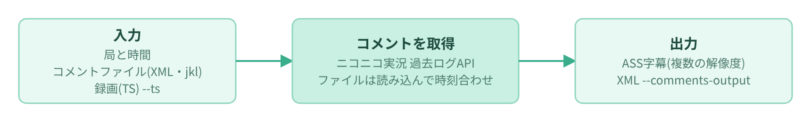

# nicojk_ass

ニコニコ実況の過去ログ(コメント)を取得し、ASS字幕にするツールです。

過去ログは [ニコニコ実況 過去ログ API](https://jikkyo.tsukumijima.net)から取得します。

## 機能

- 局と時間を指定して、コメントを取得してASSに変換
- コメントファイル(XML、NicoJKのjkl)をASSに変換(取得元の時刻合わせを含む)
- 別の局のコメントの統合・差し替え(`--mode merge|replace`)
- 別の局のコメントの時刻合わせ方は下記に対応
  - 時刻の対応表(`--timemap`)
  - 音声の照合(WAVは`--wav`・`--ref-wav`、TSは`--ref-ts`・`--decoder`)
  - コメントの照合(`--ref-sid`など)
- 別の時間の録画を、しょぼいカレンダーとフォルダから自動で検索(`--alt`、`plan`)
- 録画(TS)を渡すだけで動かす。放送時刻と音声はTSから取得(`--ts`)
- 複数の解像度のASSを一度に出力
- 統合したコメントを過去ログと同じXMLで出力(`--comments-output`)

### 基本機能



### 別の局のコメントを使う機能


## 実行方法

nicojk_assの実行ファイルを配布しているのでこれを直接実行します。また、pythonスクリプトをそのまま実行することもできます。

### nicojk_ass 実行ファイル

[こちら](https://github.com/rigaya/nicojk_ass/releases)から、環境に合うものをダウンロード・展開して実行してください。

```sh
./nicojk_ass make --sid 211 --start 2026-11-19T21:00:00 --end 2026-11-19T21:30:00 --output 1920x1080=out.ass
```

### nicojk_ass.py スクリプト実行の場合

`nicojk_ass.py`を実行します。python 3.10以上が必要です。

音声で照合する(`--ref-wav`、`--ref-ts`、`--alt`、`align`)ときは追加でnumpyが必要です。

```sh
pip install numpy
python3 nicojk_ass.py make --sid 211 --start 2026-11-19T21:00:00 --end 2026-11-19T21:30:00 --output 1920x1080=out.ass
```

### ffmpeg

さらに、`--ts`と`--decoder ffmpeg`には追加でffmpegが必要です(実行ファイルでもスクリプト実行でも同じ)。`PATH`にあるものを使うか、`--decoder ffmpeg=PATH`で指定してください。

## 使い方

時刻はUNIX秒(小数可)、ISO 8601(タイムゾーンを省くとJST)、14桁のJST(`YYYYMMDDhhmmss`)のどれでもOKです。

- 例1: 局のコメントをAPIから取得

  `nicojk_ass make --sid 211 --start 2026-11-19T21:00:00 --end 2026-11-19T21:30:00 --output 1920x1080=out1080.ass --output 1280x720=out720.ass`

- 例: コメントファイルを使用(番組開始の時刻を合わせる)

  `nicojk_ass make --comments-file comments.xml --start 20261119210000 --end 20261119213000 --comments-start 20261119210000 --output 1920x1080=out.ass`

- 例: 時刻はTSの見出しから求め、同じフォルダの先行放送も探す例 (要ffmpeg)

  `nicojk_ass make --ts 対象.ts --alt merge --search-dir <録画フォルダ> --output 1920x1080=out.ass`

- 例: 統合だけ行い、過去ログと同じXMLで出力

  `nicojk_ass make --ts 対象.ts --alt merge --search-dir <録画フォルダ> --comments-output merged.xml`


## `make`モード

### 基本オプション

対象の録画の時刻と、コメントの取得元を、それぞれ次のどちらかで指定します。

**対象の録画の時刻**(表の2つのどちらか一方を指定)

| 指定 | 内容 |
|---|---|
| `--ts F` | 録画(TS)の見出しから、先頭と末尾の時刻を読む。`--sid`を省くとTSのServiceIdを使う(映像が複数あるときは`--sid`で選ぶ) |
| `--start T` `--end T` | 録画の先頭と末尾の時刻を指定する |

**コメントの取得元**(表の2つのどちらか一方を指定)

| 指定 | 内容 |
|---|---|
| `--sid N` / `--channel jkN` | 過去ログAPIから取得する。`--sid`はServiceIdから`ch_sid.txt`でjk番号を引く。両方あれば`--channel`を使う。`--ts`なら省略できる |
| `--comments-file F` | コメントファイル(`.xml`、`.jkl`)を読む |

**補助**

| オプション | 内容 |
|---|---|
| `--program-start T` | 録画した放送の開始時刻。省略時は録画の先頭 |
| `--comments-start T` | (ファイルのみ)ファイルで番組開始に当たる時刻。省略時は`--program-start`。ファイルで省略すると、録画の範囲に半数以上のコメントが入っていれば番組開始、そうでなければ最初のコメントに合わせる(警告を出す) |
| `--comments-file-auto` | (ファイルのみ)ファイルは自動で見つけた同名ファイル。コメントが1件もなければ警告し、`--sid`/`--channel`でAPIから取得する |
| `--comments-offset S` | 取得範囲を、ここで指定した秒数だけ前へずらす |
| `--api-url URL` | (APIのみ)過去ログAPIのベースURL |

ASSの時刻0は取得範囲の始まりです。取得範囲の始まりは`録画の先頭 + (--comments-start − --program-start) − --comments-offset`、長さは録画の長さになります。

### 出力

| オプション | 内容 | デフォルト |
|---|---|---|
| `--output WxH=PATH` | 解像度ごとのASSの出力先。繰り返し指定できる。取得は1回だけ | なし |
| `--comments-output F` | 統合などの結果を、ニコニコ実況の過去ログと同じXMLで出力 | なし |
| `--font NAME` | フォント名 | `MS PGothic` |
| `--fontsize N` | フォントサイズ(ピクセル、正の整数) | 解像度の高さから決める(`高さ×37÷720`、最小16。1080pで55、720pで37) |
| `--display-seconds S` | コメントを表示する秒数(スクロールと上下の固定の両方) | 6.0 |
| `--opacity A` | 不透明度(0.0〜1.0。1.0で不透明) | 1.0 |
| `--report F` | 取得元、範囲、件数、終了の理由などをJSONで書く(`"schema": 1`) | 書かない |

`--output`と`--comments-output`のどちらかが必要です。

### 別の局のコメントを使う

同じ番組を放送した別の局のコメントを、時刻を合わせて統合したり差し替えたりすることができます。

手元にあるものに応じて、次のどれか1つを指定します。

| 手元にあるもの | 指定するオプション | 時刻の合わせ方 |
|---|---|---|
| 録画のフォルダ(別の局の録画を自動で探す) | `--alt merge --search-dir D` | 録画が見つかれば音声、なければコメントで照合 |
| 別の局の録画(TS) | `--ref-ts F` | 音声で照合 |
| 別の局の音声(WAV) | `--ref-wav F` `--ref-sid N` `--ref-start T` `--ref-end T` | 音声で照合 |
| 別の局の放送時刻だけ | `--ref-sid N` `--ref-start T` `--ref-end T` | コメントで照合 |
| 時刻の対応表 | `--timemap F` `--ref-sid N` `--ref-start T` `--ref-end T` | 対応表のとおり |

- 時刻を合わせられなかったときは、警告を出して対象の局のコメントだけを使用します(終了コード0)。
- 別の局のコメントを使うときは、`--comments-file`・`--comments-start`・`--comments-offset`は指定できません。

#### 別の局のコメントを使う際のコマンド例

- 録画のフォルダから自動で探す

  `nicojk_ass make --ts 対象.ts --alt merge --search-dir <録画のフォルダ> --output 1920x1080=out.ass`

- 別の局の録画を指定する

  `nicojk_ass make --ts 対象.ts --ref-ts 別の局.ts --output 1920x1080=out.ass`

- 別の局の放送時刻だけを指定する

  `nicojk_ass make --sid 211 --start 2026-11-19T21:00:00 --end 2026-11-19T21:30:00 --ref-sid 1064 --ref-start 2026-11-12T21:00:00 --ref-end 2026-11-12T21:30:00 --output 1920x1080=out.ass`

#### 別の局のコメントを使う際の関連オプション

- 共通のオプション

  | オプション | 内容 | デフォルト |
  |---|---|---|
  | `--mode replace\|merge` | `replace`は別の局のコメントだけを使う。`merge`は対象の局のコメントと統合する。`--alt`のときは`--alt`の値を使う(同時に指定できない) | `merge` |
  | `--ref-sid N` / `--ref-channel jkN` | 別の局。両方あれば`--ref-channel`を使う。`--ref-ts`では録画のサービスを選ぶのに使う(省略時は最初の映像のサービス)。`--alt`では指定しない | なし |
  | `--ref-start T` `--ref-end T` | 別の局の放送(録画)の先頭と末尾の時刻。`--ref-ts`と`--alt`では録画から読むので指定しない | なし |
  | `--ref-comments-file F` | 別の局のコメントをファイルから読む(APIは使わない)。`--ref-sid`の代わりに使える。`--alt`では使えない | なし |
  | `--mark-reference-color COLOR` | 統合で、別の局のコメントにこの色を足す(調査用) | なし |

- `--alt`(録画の自動検索)

  | オプション | 内容 | デフォルト |
  |---|---|---|
  | `--alt replace\|merge` | 別の局の放送と録画を自動で探して使う。値の意味は`--mode`と同じ。`--sid`が要る(`--ts`ならTSのServiceIdでよい) | なし |
  | `--search-dir D` | 録画を探すフォルダ(`--alt`では必須)。繰り返し指定できる。サブフォルダは見ない | なし |
  | `--exclude F` | 探す対象から除くファイル(対象の録画自身など)。繰り返し指定できる | なし |
  | `--cache-dir D` | しょぼいカレンダーの応答とTSの見出しのキャッシュの置き場所 | Windowsは`%LOCALAPPDATA%\nicojk_ass`、Linuxは`$XDG_CACHE_HOME/nicojk_ass`(なければ`~/.cache/nicojk_ass`) |

  - 流れ

    1. しょぼいカレンダーで対象の放送を特定し、同じ回の別の局の放送を候補にする。先の放送と同時刻の放送を先に、あとの放送をそのあとに使う(それぞれ早い順)。あとの放送は、過去ログにコメントが入るのを待つため、終わってから10分たったものだけを使う。
    2. フォルダの録画を、TSの見出し(ServiceIdと開始時刻)で確かめて探す。
    3. 録画が見つかり、対象の音声があれば、録画をデコードして音声で照合する。
    4. 録画が見つからない、または対象の音声がなければ、候補の放送のコメントで照合する(候補の順に、コメントが足りる最初の候補を使う)。
    5. どれもできなければ、対象の局のコメントだけを使う。

  - 対象が遅れネット・独自枠(対象の局のjk番号のコメントが別の番組のもの)のときは、対象の局のコメントは使わない。別の局の録画を使えれば`merge`を指定しても`replace`にし、使えなければ実況を付けずに終了コード100で終わる。

  - `--report`には、`"alt"`(`plan`と同じ内容)と`"decode"`(デコードの結果)が入る。

- 音声

  | オプション | 内容 | デフォルト |
  |---|---|---|
  | `--wav F` | 対象の音声。PCMのWAV。 | `--ts`ならTSからデコードして作る |
  | `--ref-wav F` | 別の局の音声(`--wav`と同じ形式) | なし |
  | `--decoder amatsukaze=PATH` | TSのデコードにAmatsukazeCLIを使う。`PATH --mode nicojk_wav -i TS -s SID -o WAV`を実行し、`WAV.json`を読む | `--ts`ならffmpeg、それ以外はなし(TSをデコードしない) |
  | `--decoder ffmpeg[=PATH]` | TSのデコードにffmpegを使う。ドロップは無音で埋め、映像と音声の先頭のずれはWAVの先頭を切るか無音を足して合わせる。PATHを省くと`ffmpeg`を探す | 同上 |
  | `--work-dir D` | デコードしたWAVの置き場所 | OSの一時フォルダに作り、終わったら消す |
  | `--keep-work` | デコードしたWAVを消さずに残す | 消す |

  - 音声の形式が途中で変わる録画(5.1chとステレオの切り替えなど)は、ffmpegが最後まで書けなければ、その録画は使わない。
  - 照合の結果は`--report`の`"align"`に入る。

- コメントでの照合

  - 別の局の放送の先頭と末尾(`--ref-start`・`--ref-end`)に前後300秒を足してコメントを取得し、対象の局のコメントとの本文の一致で時刻のずれを推定する。探索の中心は`--ref-start`と`--program-start`の差。コメントが少ない、またはどの区間も推定できなければ、対象の局のコメントだけを使う。結果は`--report`の`"comment_align"`に入る。

  | オプション | 内容 | デフォルト |
  |---|---|---|
  | `--spans F` | 本編の区間のJSON(`{"spans": [[開始, 終了], ...]}`、`--start`からの秒)。本編の区間ごとにずれを推定する。不正なら終了コード1 | なし(窓ごとに推定する) |

- 対応表

  | オプション | 内容 | デフォルト |
  |---|---|---|
  | `--timemap F` | 別の局の時刻から対象の時刻への対応表。JSONで、`[別の局の開始, 別の局の終了, 対象の開始, 対象の終了]`を並べる | なし |

### 終了コード


  | 値 | 内容 |
  |---|---|
  | 0 | 成功(コメントが0件でも出力を書く) |
  | 100 | 付けるコメントがない(局にjk番号がない、APIが400/404を返した) |
  | 1 | エラー |


## `plan`モード

`--alt`の前半(放送の特定と録画の探索)だけを行い、結果をJSONで出す。デコードも照合もしない。`--alt`がどの録画を選ぶかを、前もって確かめるのに使う。

```sh
nicojk_ass plan --sid 211 --start 2026-10-09T00:00:00 --search-dir <録画のフォルダ> --report plan.json
```

- オプション

  | オプション | 内容 | デフォルト |
  |---|---|---|
  | `--sid N` | 対象の局のServiceId(放送の特定に要る) | なし |
  | `--start T` | 対象の録画の先頭の時刻(必須) | なし |
  | `--program-start T` | 録画した放送の開始時刻。これと開始時刻が10分以内の放送を探す | `--start` |
  | `--search-dir D` | 録画を探すフォルダ。繰り返し指定できる。サブフォルダは見ない | なし(録画は探さない) |
  | `--exclude F` | 探す対象から除くファイル。繰り返し指定できる | なし |
  | `--cache-dir D` | キャッシュの置き場所(`make`と同じ) | `make`と同じ |
  | `--report F` | 結果のJSONを書くファイル | 標準出力 |

- 出力(JSON)

  | キー | 内容 |
  |---|---|
  | `program` | 特定した放送(しょぼいカレンダーのTID、話数、タイトル、開始と終了) |
  | `target` | 対象の局。`comments`は次のどれか<br>`ok`: 対象の局のコメントを使える<br>`unrelated`: 遅れネット・独自枠<br>`unknown`: 判断できない |
  | `candidates` | 別の局の候補(使う順)。局、放送の開始と終了、同時刻の放送か、見つかった録画 |
  | `probed` | TSの見出しを確かめたファイルと、その結果 |
  | `reference` | 選んだ録画(パス、ServiceId、候補の番号)。なければ`null` |
  | `error` | 失敗の理由。なければ`null` |
  | `log` | 処理の記録 |

- 終了コード
  
  0(録画が見つからなくても0)、1は結果を書けなかったとき。

## `align`(開発用)モード

```sh
python3 nicojk_ass.py align --wav 対象.wav --ref-wav 別の局.wav [--report result.json]
```

音声照合だけを行い、区間・ずれ・相関比・対応表をJSONに書く(`--report`を省くと標準出力)。拡張子が`.f32`のファイルは、8kHzモノラルのfloat32の生のPCMとして読む。終了コードは、成功0、照合の失敗1、その他のエラー2。

## 開発

→ [開発メモ](dev_memo.md)

## ライセンス

- このリポジトリのソース(`_vendor/`以外)はMIT License。
- `src/nicojk_ass/_vendor/danmaku2ass.py`は[danmaku2ass](https://github.com/m13253/danmaku2ass)のもので、ライセンスはGPL-3.0。
- danmaku2assを含むため、配布するexe(zip)はGPL-3.0になる。

