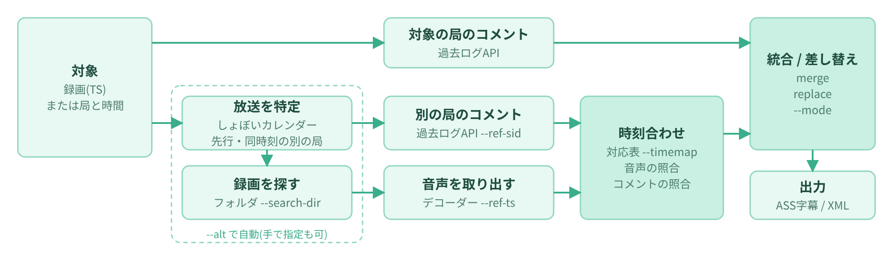

# nicojk_ass

ニコニコ実況の過去ログ(コメント)を取得し、ASS字幕にするツール。[Amatsukaze](https://github.com/rigaya/Amatsukaze)から呼び出して使う。単体でも使える。

過去ログは [ニコニコ実況 過去ログ API](https://jikkyo.tsukumijima.net)から取得する。

## 機能

- 局と時間を指定して、コメントを取得してASSにする
- コメントファイル(XML、NicoJKのjkl)をASSにする(取得元の時刻合わせを含む)
- 別の局のコメントの統合・差し替え(`--mode merge|replace`)
- 別の局のコメントの時刻合わせ方は下記に対応
  - 時刻の対応表(`--timemap`)
  - 音声の照合(WAVは`--wav`・`--ref-wav`、TSは`--ref-ts`・`--decoder`)
  - コメントの照合(`--ref-sid`など)
- 別の時間の録画を、しょぼいカレンダーとフォルダから自動で探す(`--alt`、`plan`)
- 録画(TS)を渡すだけで動かす。放送時刻と音声はTSから読む(`--ts`)
- 複数の解像度のASSを一度に出す
- 統合したコメントを過去ログと同じXMLで出す(`--comments-output`)

基本の流れ:


別の局のコメントを使う流れ:



## 入手と実行

### 実行ファイル

リリースのページから、環境に合うものをダウンロードして展開する。

| zip | 内容 |
|---|---|
| `nicojk_ass-<version>-windows-x64.zip` | Windows x64 |
| `nicojk_ass-<version>-linux-x64.zip` | Linux x64(glibc 2.28以上) |
| `nicojk_ass-<version>-linux-arm64.zip` | Linux arm64(glibc 2.28以上) |

```sh
./nicojk_ass make --sid 211 --start 2026-11-19T21:00:00 --end 2026-11-19T21:30:00 --output 1920x1080=out.ass
```

### ソースのまま

Python 3.10以上が必要。

- 追加の依存モジュール

  - 音声照合(`--ref-wav`、`--alt`、`--ref-ts`、`align`)
    - numpy 
  - `--ts`と`--decoder ffmpeg`
    - ffmpeg

## 使い方

```sh
# 局のコメントをAPIから取得する
python3 nicojk_ass.py make --sid 211 \
    --start 2026-11-19T21:00:00 --end 2026-11-19T21:30:00 \
    --output 1920x1080=out1080.ass --output 1280x720=out720.ass

# コメントファイルを使う(番組開始の時刻を合わせる)
python3 nicojk_ass.py make --comments-file comments.xml \
    --start 20261119210000 --end 20261119213000 --comments-start 20261119210000 \
    --output 1920x1080=out.ass

# 録画を渡す。時刻はTSの見出しから求め、同じフォルダの先行放送も探す(ffmpegが要る)
python3 nicojk_ass.py make --ts 対象.ts --alt merge --search-dir 録画のフォルダ \
    --output 1920x1080=out.ass

# 統合だけ行い、過去ログと同じXMLで書く(他のアプリがdate/date_usecで読む)
python3 nicojk_ass.py make --ts 対象.ts --alt merge --search-dir 録画のフォルダ \
    --comments-output merged.xml
```

時刻はUNIX秒(小数可)、ISO 8601(タイムゾーンを省くとJST)、14桁のJST(`YYYYMMDDhhmmss`)のどれでも可。

### `make`のオプション

対象:

| オプション | 内容 |
|---|---|
| `--ts F` | 対象の録画(TS)。`--start`と`--end`の代わりに、見出しから先頭と末尾の時刻を求める。映像が複数あるときは`--sid`で選ぶ。`--start`・`--end`とは同時に指定できない |
| `--sid N` / `--channel jkN` | 対象の局。`--sid`はServiceIdから`ch_sid.txt`でjk番号を引く。両方あれば`--channel`を使う |
| `--start T` `--end T` | 対象の録画の先頭と末尾の時刻。ASSの時刻0は取得範囲の始まり。`--ts`のときは不要 |
| `--program-start T` | 録画した放送の開始時刻。省略時は`--start` |
| `--comments-file F` | コメントファイル(`.xml`、`.jkl`)。指定すればAPIは使わない |
| `--comments-start T` | コメントの時刻の基準(番組開始に当たる時刻)。省略時は`--program-start`。ファイルで省略すると、録画の範囲に半数以上のコメントが入っていれば番組開始、そうでなければ最初のコメントを基準にする(警告を出す) |
| `--comments-offset S` | 取得範囲を、ここで指定した秒数だけ前へずらす(取得範囲の始まりから引く) |
| `--comments-file-auto` | `--comments-file`は自動で見つけた同名ファイル。コメントが1件もなければ警告してファイルを使わず、`--sid`/`--channel`でAPIから取得する |

取得範囲の始まりは`--start + (--comments-start − --program-start) − --comments-offset`、長さは`--end − --start`。

基準(別の局のコメントを時刻の対応表で写して使う):

| オプション | 内容 |
|---|---|
| `--timemap F` | 基準の時刻から対象の時刻への対応表(JSON。`[基準の開始, 基準の終了, 対象の開始, 対象の終了]`の並び) |
| `--ref-sid N` / `--ref-channel jkN` | 基準の局 |
| `--ref-start T` `--ref-end T` | 基準の録画の先頭と末尾の時刻 |
| `--wav F` `--ref-wav F` | 対象と基準の音声(16bit・8kHzのWAV。モノラルかステレオで、ステレオは平均する)。`--ref-wav`を指定すると音声照合で対応表を作る(`--timemap`とは同時に指定できない。`--wav`、`--ref-start`、`--ref-end`と、`--ref-sid`・`--ref-channel`・`--ref-comments-file`のどれかが要る)。照合に失敗したら警告を出し、基準を使わずに対象の局の通常の取得へ進む。結果は`--report`の`"align"`に入る |
| `--ref-sid N`(または`--ref-channel jkN`) `--ref-start T` `--ref-end T` | `--timemap`・`--ref-wav`・`--alt`・`--ref-ts`がないときの方式D。基準の放送の`StTime`・`EdTime`を渡すと、前後300秒を足してコメントを取得し、対象の局のコメントとの本文の一致で時刻のずれを推定する。探索の中心は`--ref-start`と`--program-start`(省略時は`--start`)の差。コメントが少ない、またはどの区間も推定できなければ、警告を出して対象の局のコメントだけを使う。結果は`--report`の`"comment_align"`に入る |
| `--spans F` | 本編の区間のJSON(`{"spans": [[開始, 終了], ...]}`、`--start`からの秒)。方式Dで、本編の区間ごとにずれを推定する(なければ窓ごとに推定する)。ほかの経路では読むだけで使わない。不正なら終了コード1 |
| `--ref-comments-file F` | 基準のコメントファイル(指定すればAPIは使わない) |
| `--mode replace\|merge` | `replace`は基準のコメントだけ、`merge`は対象の局のコメントと統合する(既定は`replace`) |
| `--alt replace\|merge` | 先行放送・同時刻の放送の録画を`--search-dir`から探して基準にする。`--mode`の代わりに、この値を使う。`--sid`が要る |
| `--search-dir D` `--exclude F` | `--alt`で録画を探すフォルダ(サブフォルダは見ない。繰り返し可)と、探す対象から除くファイル(対象の録画自身) |
| `--ref-ts F` | 基準の録画(TS)を手で指定する。デコードして音声照合する。`--ref-sid`でServiceIdを指定できる |
| `--decoder amatsukaze=PATH` | 基準(と、`--ts`で`--wav`がないときの対象)の音声をデコードするAmatsukazeCLI。`PATH --mode nicojk_wav -i TS -s SID -o WAV`を実行し、`WAV.json`を読む |
| `--decoder ffmpeg[=PATH]` | ffmpegで主音声を8kHz・16bit・モノラルにする。サービスは音声のPIDで選ぶ。ドロップは`aresample=async=1`で無音にする。映像と音声の先頭のずれは、WAVの先頭を切るか無音を足して合わせる。`--ts`で省略したときの既定。PATHを省くと`ffmpeg`を探す |
| `--cache-dir D` | しょぼいカレンダーの応答とTSの見出しのキャッシュ。既定はWindowsが`%LOCALAPPDATA%\nicojk_ass`、Linuxが`$XDG_CACHE_HOME/nicojk_ass`(なければ`~/.cache/nicojk_ass`) |
| `--work-dir D` `--keep-work` | デコードしたWAVの置き場所(既定はOSの一時フォルダに作り、終わったら消す)。`--keep-work`で残す |

`--alt`の流れ: しょぼいカレンダーで放送を特定し、同じ回の先行放送・同時刻の放送を候補にして、フォルダの録画をTSの見出し(ServiceIdと開始時刻)で確かめる。録画が見つかればデコードして音声照合する(`--wav`と`--decoder`が要る)。
`--alt`と`--ref-ts`は`--timemap`・`--ref-wav`とは同時に指定できない(`--alt`と`--ref-ts`も同時には指定できない)。

- 録画が見つからない、しょぼいカレンダーやデコード、照合に失敗した、`--wav`や`--decoder`がない: 警告を出して対象の局のコメントだけにする(終了コード0)。`--ts`でデコーダーを省いたときはffmpegを使う。
- 対象が遅れネット・独自枠(対象の局のjk番号のコメントが別の番組のもの)で、基準を使えない: 実況を付けず、終了コード100。遅れネットで基準を使うときは、`merge`を指定しても`replace`にする。
- 音声の形式が途中で変わる録画(5.1chとステレオの切り替えなど)は、ffmpegが最後まで書けなければ、その基準は使わず対象の局のコメントに戻る。

`--report`には、`"alt"`(`plan`と同じ内容)と`"decode"`(デコードの結果)が入る。

出力:

| オプション | 内容 |
|---|---|
| `--output WxH=PATH` | 解像度ごとのASSの出力先。繰り返し指定できる。取得は1回だけ |
| `--comments-output F` | 統合などの結果を、ニコニコ実況の過去ログと同じXML(`<packet>`の中の`<chat>`)で書く。時刻は対象の録画の先頭を0にしたときの絶対時刻で、`date`と`date_usec`に入る。`vpos`は実況スレッド開始(4:00 JST)からのセンチ秒。`--output`を省くとASSは作らない。両方指定するとXMLとASSを両方書く |
| `--font` `--fontsize` `--display-seconds` `--opacity` | フォント、サイズ(省略時は解像度から決まる)、スクロールコメントの表示秒数、不透明度 |
| `--report F` | 取得元、範囲、件数、終了の理由などをJSONで書く(`"schema": 1`) |
| `--mark-reference-color COLOR` | 統合で基準の局のコメントにこの色を足す(調査用) |
| `--api-url URL` | 過去ログAPIのベースURL |

終了コード: 0は成功(コメントが0件でも出力を書く)、100は付けるコメントがない(局にjk番号がない、APIが400/404を返した)、1はエラー。

### `plan`

```sh
python3 nicojk_ass.py plan --sid 211 --start 2026-10-09T00:00:00 --search-dir /rec [--exclude F] [--cache-dir D] [--report plan.json]
```

`--alt`の放送の特定と録画の探索だけを行い(デコードも照合もしない)、結果をJSONで出す(`--report`を省くと標準出力)。`program`(特定した放送)、`target`(対象の局。`comments`は`ok`、`unrelated`(遅れネット・独自枠)、`unknown`)、`candidates`(基準の候補と見つかった録画)、`probed`(TSの見出しを確かめたファイルと結果)、`reference`(選んだ録画。なければnull)、`error`、`log`が入る。

### `align`(開発用)

```sh
python3 nicojk_ass.py align --wav 対象.wav --ref-wav 基準.wav [--report result.json]
```

音声照合だけを行い、区間・ずれ・相関比・対応表をJSONに書く(`--report`を省くと標準出力)。拡張子が`.f32`のファイルは、8kHzモノラルのfloat32の生のPCMとして読む。終了コードは、成功0、照合の失敗1、その他のエラー2。

## 開発

→ [開発メモ](dev_memo.md)

## ライセンス

- このリポジトリのソース(`_vendor/`以外)はMIT License(`LICENSE`)。
- `src/nicojk_ass/_vendor/danmaku2ass.py`は[danmaku2ass](https://github.com/m13253/danmaku2ass)のもので、ライセンスはGPL-3.0。
- danmaku2assを含むため、配布するexe(zip)はGPL-3.0になる。

